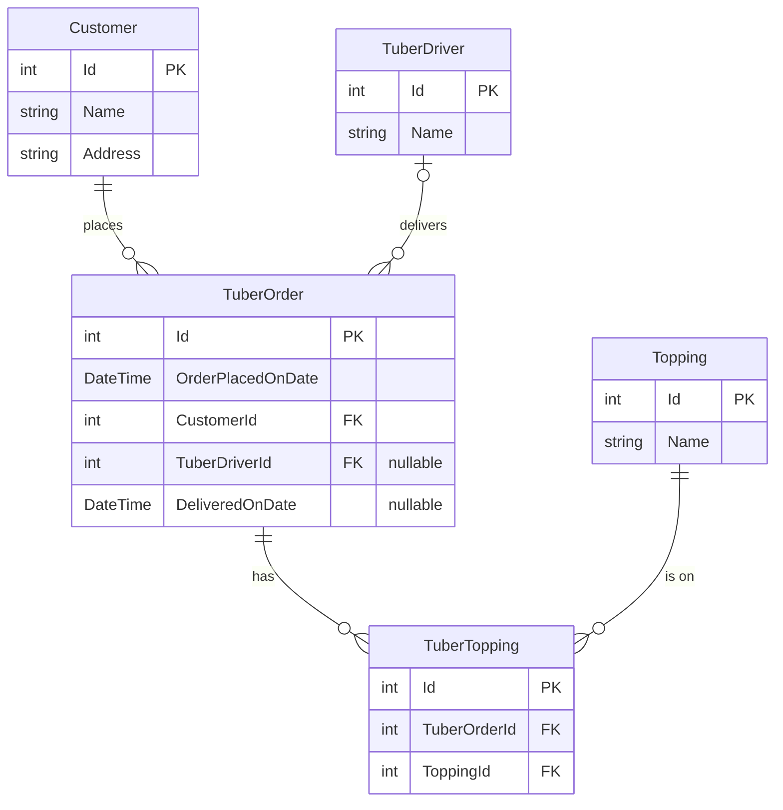

# Tuber Treats API

An ASP.NET minimal API for a baked potato delivery service. Data is stored in memory
in `Program.cs`, so it resets every time the app restarts.

## ERD

**Relationships**

- A customer can place many orders. Each order belongs to exactly one customer.
- A driver can deliver many orders. An order has zero or one driver, because
  `TuberDriverId` stays null until a driver is assigned.
- Orders and toppings are many-to-many. `TuberTopping` is the join table that
  connects them.

`Customer.TuberOrders`, `TuberDriver.TuberDeliveries`, `TuberOrder.Customer`,
`TuberOrder.TuberDriver`, and `TuberOrder.Toppings` are C# properties the API fills
in when it responds. They are not columns, so they are left out of the ERD.
